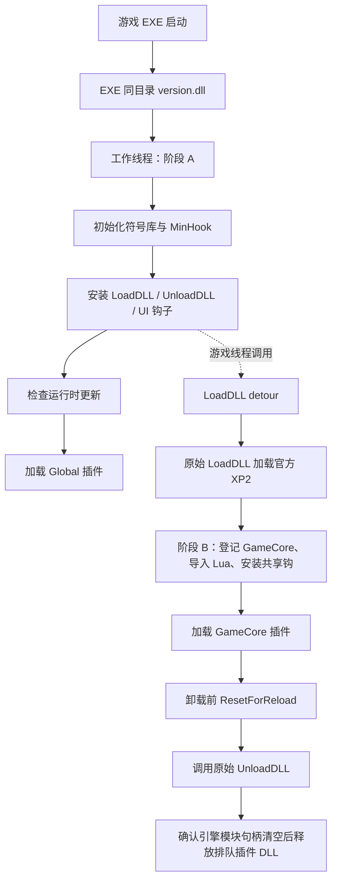

# Civ6DllLoader 代码阅读指南

日期：2026-09-18。依据：本次检查时的工作区，HEAD 为 `7d80611`，**包含检查前已经暂存的生命周期相关修改**。本文说明实际实现和阅读方法；缺陷、验证结果及旧文档差异见 [代码审查报告](CODE_REVIEW_2026-09-18.md)。

本项目是 Windows x64 的《文明 VI》原生插件加载基础设施。它会修改游戏函数入口、执行第三方 DLL、使用逆向得到的函数签名，并跨越 GameCore/Lua 的销毁边界。因此，理解“谁拥有这块内存、谁还可能调用它、地址来自哪个版本”，比单看函数是否返回成功更重要。

## 1. 先建立运行图景

解决方案只有两个工程，插件示例不在本仓库。

| 工程/文件 | 角色 | 实际部署形态 |
| --- | --- | --- |
| `DllLoader` | 薄壳，转发官方 XP2 GameCore 导出；缺少运行时代理时负责首次安装 | Mod 的 `Binaries/Win64/GameCore_XP2_Shell_FinalRelease.dll` |
| `DllLoaderRuntime` | 常驻运行时，插件发现、HookAPI、消息、符号矫正、UI、更新 | 构建名 `Civ6DllLoader.runtime.dll`；安装到游戏 EXE 目录后名为 `version.dll` |
| `ProxyExports.cpp` | 向系统 `version.dll` 转发 17 个版本 API 导出 | 包含在运行时内 |
| `common/HookAPI.h` | 插件 ABI、类型、辅助解析函数、类别编译约束 | 插件编译时使用 |
| `Plugins/Global/*.dll` | EXE 等常驻域插件 | 启动时加载一次，开关 Mod 后需重启 |
| `Plugins/GameCore/*.dll` | 随 XP2 对局加载/卸载的插件 | 每次 GameCore 阶段重新扫描 |



首次尚未安装 `version.dll` 时，薄壳发现候选运行时，暂存并发布代理，然后请求重启游戏。**正常运行时的启动入口是代理 DLL，不是薄壳主动启动 Runtime。** Mod 如何让游戏选择这个薄壳，还需要外部 Mod 的配置；仓库没有完整发行 Mod 示例可供端到端核验。

当前 GameCore 自动编排针对 `EXPANSION_2`。EXE 支持 DX11 和 DX12 两种身份；入口休眠检测接受 `CivilizationVI*.exe`，但后续映像识别使用已知的两个准确文件名，不能据此推断任意改名或未来变体都兼容。

## 2. 推荐精读顺序

不要从约 3,800 行的 API 实现文件第一行一路读到底。每轮沿一条调用链阅读，并记录下面的问题。

| 轮次 | 先读的文件与函数 | 这一轮应能回答的问题 |
| --- | --- | --- |
| 1：工程边界 | [README](../README.md)、[解决方案](../DllLoader.sln)、两个 `.vcxproj`、[LoaderProtocol.h](../common/LoaderProtocol.h)、[LoaderVersion.h](../common/LoaderVersion.h) | 哪些源码真正参与构建？输出名、资源号、链接库、工具集是什么？ |
| 2：启动链 | [ShellBootstrap.cpp](../DllLoader/ShellBootstrap.cpp) 的 `InstallLoaderIfMissing` / `LoadRealGameCore`；[RuntimeEntry.cpp](../DllLoaderRuntime/RuntimeEntry.cpp) 的 `DllMain` / `WorkerMain` / `InitEarly` | 首次安装与日常启动如何区分？哪些步骤失败后仍继续？ |
| 3：阶段转换 | [LoaderHooks.cpp](../DllLoaderRuntime/LoaderHooks.cpp) 的 `InstallAll` / 两个 detour；[LoaderCore.h](../DllLoaderRuntime/LoaderCore.h)；API 实现的 `InitializeGameCorePhase` / `ResetForReload` | 什么信号表示已加载、开始销毁、实际卸载完成？ |
| 4：插件身份 | [ModScan.cpp](../common/ModScan.cpp)、[EnabledMods.cpp](../common/EnabledMods.cpp)；API 的 `LoadPluginDllInternal` / `UnloadPluginAt` / `QuarantinePluginByOwner` | 哪个 DLL 被选中？模块引用、owner、状态各自什么时候失效？ |
| 5：回调并发 | [PluginInFlight.cpp](../DllLoaderRuntime/PluginInFlight.cpp)、[Civ6MessageBus.cpp](../DllLoaderRuntime/Civ6MessageBus.cpp)、[生命周期自测](../tools/runtime_lifetime_selftest.cpp) | 旧快照如何拒绝新一代插件？谁等待谁？回调自注销如何避免等自己？ |
| 6：机器码修改 | API 的 `HookSite`、`GetOrCreateHookSiteLocked`、`InstallHookImpl`、capture；[PatchRegistry.cpp](../DllLoaderRuntime/PatchRegistry.cpp) | 原入口、跳板、stub、detour 各指向哪里？修改范围与回滚顺序是否一致？ |
| 7：取址 | [HookAPI.h](../common/HookAPI.h) 的解析辅助函数；[ImageAddress.cpp](../DllLoaderRuntime/ImageAddress.cpp)、[PdataMatch.cpp](../DllLoaderRuntime/PdataMatch.cpp)、[NormHash.cpp](../DllLoaderRuntime/NormHash.cpp) | 输入是旧版 RVA、当前 RVA、段内偏移还是绝对地址？结果有什么证据？ |
| 8：游戏 ABI | [HavokScript.cpp](../DllLoaderRuntime/HavokScript.cpp)、[Localization.cpp](../DllLoaderRuntime/Localization.cpp)、API 的事件/ScriptGlobals/PushMethods；[UiInject.cpp](../DllLoaderRuntime/UiInject.cpp) | Lua 栈、对象布局、函数签名、虚表偏移依赖哪一版游戏？ |
| 9：发布路径 | [RuntimePackage.cpp](../common/RuntimePackage.cpp)、[LoaderUpdate.cpp](../DllLoaderRuntime/LoaderUpdate.cpp)、[RestartGame.h](../common/RestartGame.h)、[symdb.py](../tools/symdb.py) | 检查的是格式还是可信来源？失败或中断后磁盘上还剩什么？ |

每读完一轮，画出成功与失败两条路径。尤其不要省略“检查成功之后、正式发布之前”的并发窗口。

### 大文件导航

以下为本次快照的近似行段，后续编辑会漂移；检索函数名更可靠。

| `Civ6DLLHookLoaderAPI.cpp` 行段 | 内容 |
| --- | --- |
| 41–440 | 插件记录、待释放队列、生命周期锁、owner 与地址域校验 |
| 441–735 | JIT 中转 stub、站点复用、独占 detour、Hook/Patch 冲突检查 |
| 738–1088 | 消息入口、映像与 RVA/名字/模式解析 |
| 1089–1440 | capture 派发、订阅清理与 GameCore 站点停用 |
| 约 1440–2025 | 游戏对象辅助接口、事件、Lua 方法描述及注册 |
| 约 2026–2500 | ScriptGlobals 共享钩、PushMethods 注入与槽位 |
| 约 2500–3015 | Lua 原语包装、动态目标注册、Patch/Unpatch |
| 约 3016–3212 | 只读 HookAPI 表、自检、内部解析表、EXE 目标解析 |
| 3215–3688 | 插件装入、隔离、卸载、扫描加载 |
| 3691–文件末 | GameCore 初始化、共享入口复位、重载清理 |

## 3. 启动、发现与加载

### 3.1 阶段 A

`RuntimeEntry::DllMain` 判断代理是否位于宿主 EXE 目录以及宿主文件名是否匹配，然后创建一次性工作线程。工作线程依次：

1. 初始化日志、检查 HookAPI 只读页、加载 sidecar、为 EXE 建立映射、初始化 MinHook。
2. 将资源中的基础 UI Lua/XML 提取到 EXE 目录下的 `Civ6DllLoader` 子目录。
3. 安装 `LoadDLL`、`UnloadDLL` 和 FrontEnd UI 钩子。
4. 检查并尝试更新运行时。
5. 加载启用 Mod 的 Global 插件，线程退出。

这是顺序执行的工作线程，但**游戏线程并不因此暂停**。钩子安装后，阶段 B 就可能被游戏线程触发；代码没有“Global 全部加载完，游戏才能进入阶段 B”的整体屏障。更新交互也发生在 Global 加载之前。审查报告 R2 说明相应待验证条件。

### 3.2 两种扫描不能混淆

扫描根来自游戏内容根、Documents 下的 Mods、Steam 安装信息及 libraryfolders 中的 Workshop `289070`，并考虑加载器自身位置。具体目录层级由 `CollectScanRoots` 和候选收集函数决定，不是对整个磁盘递归查 DLL。

**插件候选：** 收集指定类别目录 → 按启用 Mod 过滤 → 按完整路径排序 → 按 DLL 文件名不区分大小写去重。相同类别下两个 Mod 都有 `Foo.dll` 时，只会选择一个；路径顺序会影响结果，不能把加载顺序当作依赖解析器。

启用状态从 `%LOCALAPPDATA%/Firaxis Games/Sid Meier's Civilization VI/Mods.sqlite` 只读加载，查询选中的 Mod 组与扫描文件根。SQLite 忙等待为 500 ms；查询失败会丢弃不完整结果，仅保留加载器本地路径的例外。阅读 `AllowsPath` 时核对目录边界，不能用纯字符串前缀替代“属于该目录”。

**运行时候选：** 不按启用 Mod 过滤。读取 x64 DLL 的静态 RCDATA 105，按版本与路径选取候选。资源证明格式和版本，**不是发布者签名**。静态探测不执行候选 DLL 的入口；正式安装后下次游戏启动会执行它。

### 3.3 插件身份有三层

| 标识 | 用途 | 阅读时注意 |
| --- | --- | --- |
| `HMODULE` | Windows 模块句柄，定位代码所属 DLL | 句柄存在不代表 Loader 拥有可释放的引用；见 F3 |
| `ownerId` | 规范化完整路径，补丁、钩子、注册项的清理归属 | 同路径再次加载仍是新生命周期；路径规范化不是文件系统身份认证 |
| 文件 stem | 消息寻址，例如 `Foo.dll` 对应 `Foo` | 与 owner 不同；消息名字比较不要假设沿用路径的大小写规则 |

`LoadPluginDllInternal` 先取得/加载模块，再查 `Civ6PluginKind` 和 `OnLoad`。因此在类别被拒绝之前，`DllMain`、TLS 初始化及依赖 DLL 初始化可能已经运行。

`Civ6PluginKind` 的低位类别用于匹配扫描目录；ABI 高位用于诊断。插件仍应在 `OnLoad` 中调用 `HookAPI_IsCompatible`。`OnLoad` 返回类型为 `void`，插件因为不兼容而直接返回，Loader 无法由返回值区分“初始化成功”和“主动放弃”。

状态路径通常为 `Loading → Active → Deactivating → 移除`。`Loading` 已允许注册与受控回调。`OnLoad` 异常则进入 `Quarantined`，清理已登记内容并保留隔离记录，避免同路径反复加载失败。GameCore DLL 等引擎卸载后释放，Global DLL 通常保持映射。

## 4. GameCore 卸载是重点阅读区

`LoadDllDetour` 根据规则集选择官方 XP2 路径，先调用原始加载函数；随后用引擎内部的模块句柄槽与状态决定是否初始化阶段 B。阶段 B 依次登记 GameCore、准备 RVA 映射、导入 HavokScript、初始化本地化、发布 ready 状态并安装共享脚本钩，然后再加载 GameCore 插件。

`UnloadDllDetour` 的核心顺序是：

1. 记录卸载前引擎模块句柄，设置卸载窗口状态。
2. `ResetForReload` 先关闭 GameCore 就绪状态，记录正在销毁的地址范围。
3. 停用 GameCore 域站点，还原入口，清理 capture，开始卸载 GameCore 插件。
4. 插件禁止新受控回调，排空消息与 owner 在途调用；执行 `OnUnload`，回滚补丁，退役 detour/注册项，DLL 句柄进入待释放队列。
5. 将 GameCore 解析入口摘离，等待 Loader 共享 detour 计数归零，重置共享原函数与 PushMethods 槽位。
6. 调用引擎原始 `UnloadDLL`。
7. 仅在引擎模块句柄确实由非空变为空时，清除未完成状态并释放排队的插件模块。

这里有三种不同的“结束”：**禁止新登记调用、当前已计数调用结束、游戏真正不再引用插件代码。** 前两项可以从 Loader 数据结构证明；第三项依赖游戏卸载与 Lua 环境销毁的真实时序。保留 JIT 和 trampoline 能保护这些对象自身，不能证明所有插件 detour 都已经返回。

### 4.1 对象归属与寿命

| 对象 | 主要拥有者 | 实际寿命/释放点 |
| --- | --- | --- |
| `PluginEntry` | `g_plugins` | 正常卸载移除；隔离记录可能保留 |
| `PluginInFlight::Owner` | 进程内 owner 注册表 | 每次加载分配新一代；旧对象不回收，保持旧快照指针稳定 |
| 消息 handler entry | 消息总线与快照的 `shared_ptr` | 注销后仍可被旧快照持有，但其 entry gate 已关闭 |
| `HookSite`、stub、MinHook trampoline | 运行时站点表/分配器 | 退役时保留；GameCore 重载不直接释放这些机器码对象 |
| capture 输出槽 | 插件 DLL 的静态存储 | 注册要求落在 owner 模块内；堆上临时指针不能代替 |
| Lua C 闭包里的插件函数指针 | Lua 环境 | 删除 Loader 注册表不能删除已放入 Lua 表的闭包 |
| Patch 的 original 字节副本 | `PatchRegistry` | 登记期间保留；正常撤销恢复后删除记录 |
| 游戏对象、Lua state | 游戏引擎 | API 通常只是借用，不能跨对局自行缓存 |
| 本地化不透明字符串 | Loader 包装与游戏构造/析构例程 | 必须使用配对的创建/销毁 API，不能用普通字符串释放方式 |

### 4.2 锁与等待

| 同步设施 | 主要保护内容 | 核查重点 |
| --- | --- | --- |
| `g_gameCoreTransitionMutex` | 插件加载、GameCore 初始化/复位的编排 | 是递归锁；不能据此推断引擎原始卸载和整个扫描阶段都被同一临界区覆盖 |
| `g_pluginLifecycleMutex` | 插件记录、owner 校验、注册修改 | 常见外层锁；回调与在途等待需要释放它 |
| `Runtime::MinHookMutex()` | MinHook 操作与站点状态 | 通常在 lifecycle 内；再向内才进入 capture 锁 |
| `g_captureMutex` | capture 订阅、输出派发 | 在受控叶子中写插件地址，避免 SEH 跨越 C++ 锁对象 |
| script/push 状态锁 | 共享原函数、槽位、注入状态 | 对照 detour 读侧、复位写侧一起看 |
| 消息总线锁与 handler 锁 | 名字索引、快照、单 entry 在途计数 | 不在持总线锁时调用插件；替换只排空旧 entry |
| owner 计数与条件变量 | 指定加载代的受控回调 | `Enter` 先加计数后检查门禁；`WaitAll` 考虑本线程嵌套深度 |
| PatchRegistry 的 critical section | 补丁字节账本 | 目前显式进出锁，异常退出路径需要另审 |

`ResetForReload` 等共享 detour 时释放 lifecycle 锁，但外层 transition 锁仍在。不要把这描述为“等待时完全不持任何其他锁”。

## 5. Hook、capture、Patch 的区别

统一站点以目标绝对地址为键：`目标入口 → MinHook → JIT stub → nextTarget`。`nextTarget` 指向插件 detour 或 MinHook trampoline。

- 每个站点最多一个 detour，第二次占用会被拒绝。
- 同一站点可有多个 capture 输出槽，但要捕获同一个参数索引。
- 无 capture 时 stub 直接跳转；有 capture 时保存寄存器，调用 `CaptureDispatch`，恢复后跳转。支持前四个整数/指针参数，不能推断为通用任意函数签名捕获器。
- 安装 detour 时先写出 `original` 跳板，再发布 `nextTarget`，避免另一线程先进入尚未初始化的插件 detour。
- 插件退役通常是“拔掉槽位并恢复透传”，不是删除整个站点。GameCore 停用与同地址复用还有入口字节校验，保留的旧节点及跳板可能随多次不同地址重载增长。
- `Patch` 是带 owner 的原始字节覆盖：保存原内容、调整页保护、写入、恢复保护、刷新指令缓存。同 owner、同地址、同长度的重复修改保留最初字节；不是多层补丁栈。

安装 Hook 与 Patch 不能只分别审查。两者都认为自己拥有入口“原字节”时，撤销操作会互相破坏。目前冲突检查没有覆盖全部入口，见 F2。

## 6. HookAPI 与回调边界

`HookAPI` 是两个 32 位头字段加 76 个函数指针，当前 x64 大小为 616 字节，版本为 1。冻结前缀要求旧字段顺序与签名保持一致，新入口只能按 ABI 规则追加。总大小与末尾偏移检查并不能发现所有中间字段误排，审查时还要逐项对照初始化表。

| 接口族 | 阅读入口 | 关键约束 |
| --- | --- | --- |
| Hook/解析/capture/Patch | API 实现 + `ImageAddress` | owner 类别与目标地址域共同决定是否开放；地址来源必须明确 |
| 消息 | `Civ6MessageBus` | 同步调用，数据为借用缓冲；异步保留需复制；同名不同 owner 冲突会拒绝 |
| 事件、ScriptGlobals、PushMethods | API 实现中段 | GameCore 专属；受 `PluginInFlight` 管理的只是 Loader 发起的那一次回调 |
| Lua 原语 | `HavokScript` 与 API 包装 | 不都限制为 GameCore 插件，但函数导入与有效 Lua state 仍依赖阶段与线程 |
| 本地化/对象辅助 | `Localization` 与 API | 游戏 ABI、构造/析构配对、对象寿命约束 |

Global 插件通过头文件宏禁止 8 个 GameCore 专属接口；运行时还检查 owner/类别。宏不是安全隔离，原生插件仍与游戏共享进程。

ScriptGlobals 与 UI 版本在原始引擎注册函数之前调用插件。PushMethods 先准备候选注册集合、检查暴露名冲突，再提交；无 manager/有 manager 两类各有 16 个目标槽位。成功注入后，Lua 闭包可以在更晚时间执行，这段执行本身不属于注册阶段的在途计数。

`PluginBoundary` 使用页属性检查、拷贝输入、独立 SEH 叶子及隔离回调减少错误扩散。它不是原生代码沙箱，也不能保证任意 C++ 异常、并发释放内存或错误 ABI 调用都可恢复。

## 7. 地址解析：先问“这个数字属于哪套坐标”

| 入口 | 输入语义 | 当前行为与注意点 |
| --- | --- | --- |
| `ResolveByRva` | sidecar 基准版本的旧 RVA | 有上下文时先矫正；**完全没有上下文时会直接按当前映像 RVA 解析**，见 F1 |
| `ResolveByRvaEx(..., kSectionImage)` | 当前映像 RVA | 明确绕过矫正 |
| `ResolveByRvaEx(..., section)` | 当前映像指定段内的偏移 | 加上段 RVA；目前缺段内边界校验，见 F6 |
| `ResolveByName` | sidecar 名字 | 必须有对应上下文；查旧符号再矫正 |
| `ResolveByPattern` | 字节模式与段 | 返回命中地址；不能自动证明唯一性或函数类型 |
| `HookScanPatternNth` | 模式和命中序号 | 用于明确选择第 N 个结果；EXE 特殊回退遗漏该语义，见 F5 |
| 虚表解析/辅助函数 | 旧虚表槽描述及已解析映像 | 还需要确认当前槽数、对象布局和函数签名 |

`ImageAddress` 管理 EXE 与已挂接的 XP2 GameCore，并做映像范围检查。落在 `SizeOfImage` 内不等于必然可读、可执行、类型正确，更不等于此时仍处于同一次 GameCore 生命周期。

### 7.1 sidecar 数据链

源码资源 [Sidecar.rc](../DllLoaderRuntime/Sidecar.rc) 的 102 号资源来自 `Civ6DllLoader.symdb.bin.xp`。同目录开发用 `Civ6DllLoader.symdb.bin` 优先；该文件读取、解压或解析失败后再尝试内嵌资源。

```text
C6XC 压缩信封（12 字节头）
  └─ algo=1：LZMA1，含 13 字节 .lzma 头
      └─ C6SD v1 多模块容器
          ├─ 32 字节容器头
          ├─ 每模块 64 字节描述
          ├─ .pdata 签名：每条 16 字节
          ├─ 符号：每条 32 字节
          ├─ 虚表槽：每条 8 字节
          └─ 字符串堆与 AOB 数据
```

当前容器允许 imageId 1、2、5，分别是 DX11 EXE、DX12 EXE、XP2 GameCore。`ParseContainer` 验证外层，`ParseModuleData` 验证内部。外层合法不代表各内部表之间的逻辑边界都正确，见 F7。

### 7.2 不能把矫正算法当作语义证明

`PdataMatch` 使用函数大小、unwind 签名、匹配锚点和 LIS/插值，再结合函数头归一化 hash、AOB、叶函数与虚表处理构造映射。相同 PE 身份或相同 pdata 的快速路径、以及缓存复用，都有自己的假设。

精读时分别跟踪：原始上下文装入 → 当前映像建表 → identity 判断 → cache 命中/校验 → 未命中构建 → 符号解析结果发布。不要只看最后 `CorrectRva` 返回非零。

缓存指纹主要依据函数大小与 unwind hash，不完整覆盖代码内容、名字和 AOB。PE 头身份或 pdata 一致也不必然证明所有数据地址和虚表语义不变；更新游戏后应保留二进制身份、解析日志与实际调用验证证据。

## 8. UI、工具与构建

### 8.1 UI 的额外假设

`UiInject` 钩住 EXE 的 UI 加载路径，从启用 Mod 的 `.modinfo` 提取受支持的 FrontEnd UI 文件，再创建 Lua context、改父对象并初始化。它使用有限 XML 解析器，支持范围不能按完整 XML/Mod 规范推断；重点看条件节点、实体转义、路径约束和失败重试。

一些对象字段与虚表调用依赖固定偏移及签名检查。短前导签名匹配不能证明整个对象 ABI 未变。UI 根节点的原始指针还承担缓存身份作用，应验证销毁后复用同地址的情况。

### 8.2 维护工具

| 工具 | 用途 | 本轮验证边界 |
| --- | --- | --- |
| `dump_functions_idapython.py` | 从 IDA 导出函数/符号资料 | 阅读脚本，未运行 IDA |
| `symdb.py` | 模块打包、容器、压缩、校验、AOB 与 RVA 辅助、`all` 产线 | 重点检查格式、构建/验证/发布路径；未跑完整产线 |
| `rva_to_symbol/src/main.rs` | RVA 到符号的离线辅助查询 | 阅读源码，未构建 Rust 工具 |
| `aob_helper.exe` / `normhash_helper.exe` / `demumble.exe` | 离线生成/名字处理依赖 | 未审计二进制，仓库内未找到对应完整来源链 |
| `lzma_selftest.c` | 用同款 LZMA 解码器独立解包 | 本轮改用临时 C++ 探针直接运行生产解码与解析函数 |
| `runtime_lifetime_selftest.cpp` | owner 代际、消息快照和排空回归 | 已编译并通过，覆盖详情见报告 |

`symdb.py all` 需要 Python 依赖、游戏二进制和工具输入；会写部署资源，不是纯只读检查。当前是先部署后 validate，见 F9。单独检查已有资源应使用 `validate` 子命令。

### 8.3 构建与日志

工程默认是 x64、C++20、v143。标准入口是在相应 Visual Studio 开发者环境中构建：

```powershell
MSBuild.exe .\DllLoader.sln /t:Build /p:Configuration=Release /p:Platform=x64
powershell.exe -NoProfile -ExecutionPolicy Bypass -File .\tools\run_runtime_lifetime_selftest.ps1
```

第二条命令只对该 PowerShell 进程绕过脚本执行策略；是否采用应遵守实际机器策略。本次本机 VS 只注册了 v145 平台工具集，故用命令行覆盖工具集、隔离 OutDir/IntDir 完成四次构建，**未修改工程工具集配置**。完整条件见审查报告。

运行日志优先看 `%LOCALAPPDATA%/Firaxis Games/Sid Meier's Civilization VI/Logs` 中的 Loader 与 Shell 日志，顺着 `InitEarly`、映像身份、站点解析、插件加载、Reset、模块释放记录读。日志中的“地址非空”“装钩成功”只表示对应步骤通过，不能替代函数语义和寿命验证。

## 9. 阅读时持续维护的检查清单

- 每个模块句柄：借用还是自有引用？谁执行对应的 `FreeLibrary`？
- 每个插件函数指针：属于哪一代 owner？在哪个线程执行？释放前由谁证明没有调用者？
- 每个共享注册项：提交是否完整？失败是否回滚？旧快照会不会重新变为可用？
- 每处机器码写入：真实修改范围是否覆盖 hotpatch 区？所有写入者是否参与同一仲裁？
- 每次取址：旧/新坐标是否明确？段边界、溢出、唯一命中、可执行性与签名是否分别验证？
- 每条异常路径：持有哪些锁？SEH 是否越过需要析构的对象？失败状态是否仍保留恢复证据？
- 每次 GameCore 复位：入口、共享槽、Lua 环境、插件 DLL 的销毁顺序是否有独立证据？
- 每次资源发布：验证是否发生在覆盖交付物之前？失败或中断后如何恢复？

建议按 [审查报告](CODE_REVIEW_2026-09-18.md) 的 F1–F9 逐项建立修复与回归任务，再完成其中的游戏内验证矩阵。已有 [ARCHITECTURE.md](ARCHITECTURE.md) 可以作为背景，但其中与实现冲突的表述应按报告中的差异表阅读。
